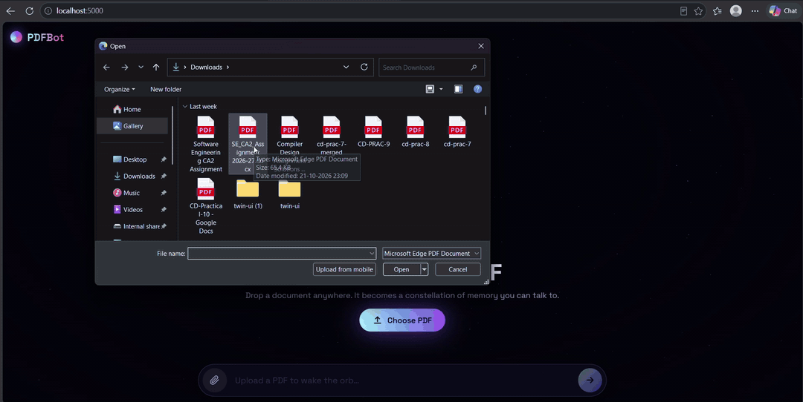

**Chat with any PDF through a living 3D "Knowledge Orb".**
PDFBot is a Retrieval-Augmented Generation (RAG) app: upload a PDF, and ask questions that are answered strictly from the document's content. The UI turns the RAG pipeline into something you can *see*: your document becomes a constellation of stars, and every question fires beams to the exact chunks the model used.



---

## Table of Contents

1. [Features](#features)
2. [How It Works](#how-it-works)
3. [Tech Stack](#tech-stack)
4. [Project Structure](#project-structure)
5. [Getting Started](#getting-started)
6. [Configuration](#configuration)
7. [API Reference](#api-reference)
8. [UI Guide](#ui-guide)
9. [Known Limitations](#known-limitations)
10. [Troubleshooting](#troubleshooting)
11. [Roadmap](#roadmap)

---

## Features

**AI / Backend**
- PDF upload and text extraction
- Recursive text chunking (1000 characters, 200 overlap)
- Semantic embeddings with Google Gemini (`gemini-embedding-001`)
- In-memory vector store with cosine-similarity search
- Top-3 retrieval, then answer generation grounded only in the retrieved context
- Returns the source chunks and similarity scores with every answer

**Frontend**
- Full-screen 3D particle orb (Three.js) that reacts to state: idle, digesting, thinking, ready
- Drag-and-drop upload anywhere on the screen, with live processing stages
- Each stored chunk appears as a star in a constellation around the orb
- Retrieval visualisation: beams shoot from the orb to the chunks used for the answer
- Typewriter answer card with clickable source chips (chunk text and match %)
- Suggested starter questions and a conversation history drawer
- Fully responsive, with a lighter 3D scene on mobile
- Single `index.html`: no build step and no framework

---

## How It Works

```
        ┌────────────┐   1. upload PDF    ┌──────────────────────────────┐
        │  Browser   │ ─────────────────► │  POST /upload                │
        │ (index.html│                    │  parse → chunk → embed       │
        │  +Three.js)│ ◄───────────────── │  → store in vectorDatabase[] │
        └─────┬──────┘   chunk count      └──────────────────────────────┘
              │
              │ 2. question
              ▼
        ┌──────────────────────────────────────────────────────────┐
        │  POST /ask                                               │
        │  embed question → cosine similarity vs all chunks        │
        │  → take top 3 → build prompt → Gemini generates answer   │
        └──────────────────────────────────────────────────────────┘
              │
              ▼
   { answer, contextUsed: [{ text, score }] }  → typed out in UI,
                                                 beams fire to the used chunks
```

**Pipeline in detail**

| Step | What happens | Where |
|------|--------------|-------|
| 1. Parse | `pdf-parse-fork` extracts raw text from the uploaded file | `/upload` |
| 2. Chunk | `RecursiveCharacterTextSplitter` splits text (1000 chars, 200 overlap) | `/upload` |
| 3. Embed | Each chunk is embedded with `gemini-embedding-001` | `embader()` |
| 4. Index | Chunks and vectors are held in the `vectorDatabase` array | memory |
| 5. Retrieve | The question is embedded and compared to every chunk by cosine similarity, and the top 3 are kept | `/ask` |
| 6. Generate | The top chunks are passed to Gemini with a "answer only from context" prompt | `/ask` |

---

## Tech Stack

| Layer | Technology |
|-------|-----------|
| Server | Node.js, Express (ES modules) |
| File upload | Multer |
| PDF parsing | pdf-parse-fork |
| Chunking | `@langchain/textsplitters` |
| Embeddings / LLM | Google Gemini via `@google/genai` |
| 3D / Frontend | Three.js (r128, CDN), vanilla JS, CSS |

---

## Project Structure

```
pdfbot/
├── server.js          # Express API: /upload and /ask
├── public/
│   └── index.html     # Entire frontend (UI + 3D scene + logic)
├── uploads/           # Temporary upload folder (files are deleted after parsing)
├── .env               # GEMINI_API_KEY (never commit this)
├── package.json
└── README.md
```

---

## Getting Started

### Prerequisites
- **Node.js 18+**
- A **Gemini API key** from [Google AI Studio](https://aistudio.google.com/)

### 1. Install

```bash
npm init -y
npm install express dotenv cors multer pdf-parse-fork @langchain/textsplitters @google/genai
```

In `package.json`, enable ES modules (the server uses `import` syntax):

```json
{
  "type": "module",
  "scripts": { "start": "node server.js" }
}
```

### 2. Add your API key

Create a `.env` file in the project root:

```env
GEMINI_API_KEY=your_api_key_here
```

### 3. Serve the frontend

Create a `public/` folder, put `index.html` inside it, and add this line to `server.js` (after `app.use(cors())`):

```js
app.use(express.static("public"));
```

### 4. Run

```bash
npm start
```

Open **http://localhost:5000**, drop a PDF onto the orb, and start asking questions.

> You can also open `index.html` directly in the browser. CORS is enabled, so it will still reach the API on port 5000.

---

## Configuration

| Setting | Location | Default | Notes |
|---------|----------|---------|-------|
| `GEMINI_API_KEY` | `.env` | none (required) | Gemini access |
| Server port | `server.js` → `app.listen` | `5000` | If you change it, also change `API` in `index.html` |
| `API` base URL | `index.html` → top of `<script>` | `http://localhost:5000` | Set this to your deployed backend URL |
| `chunkSize` / `chunkOverlap` | `server.js` | `1000` / `200` | Larger chunks mean more context per chunk but less precise retrieval |
| Top-K | `server.js` → `slice(0, 3)` | `3` | Number of chunks sent to the LLM |
| Embedding model | `server.js` | `gemini-embedding-001` | |
| Generation model | `server.js` | `gemini-3.5-flash-lite` | Change to any Gemini model you have access to |

---

## API Reference

### `POST /upload`

Uploads and indexes a PDF. Replaces any previously indexed document.

- **Content-Type:** `multipart/form-data`
- **Field:** `file` (PDF)

**Response `200`**
```json
{
  "message": "PDF Processed, embedded, and indexed succcesfully!",
  "totalChunksStored": 42
}
```

**Errors:** `400` no file uploaded, `500` failed to parse the PDF

---

### `POST /ask`

Asks a question about the indexed PDF.

- **Content-Type:** `application/json`

**Request**
```json
{ "question": "What are the key findings?" }
```

**Response `200`**
```json
{
  "question": "What are the key findings?",
  "answer": "The document concludes that...",
  "contextUsed": [
    { "text": "chunk text...", "score": 0.83 },
    { "text": "chunk text...", "score": 0.79 },
    { "text": "chunk text...", "score": 0.74 }
  ]
}
```

**Errors:** `400` question missing or no PDF uploaded yet, `500` failed to process the question

---

## UI Guide

| Orb state | Meaning |
|-----------|---------|
| Calm, slow rotation | Waiting for a PDF |
| Fast swirl and scanning ring | Uploading, embedding, indexing |
| Chunks burst out as stars | Indexing finished. Each star is one stored chunk |
| Turbulent pulse | Searching for relevant chunks and generating an answer |
| Beams to 3 stars | The exact chunks retrieved for the answer |

**Controls**
- **Upload:** drag a PDF anywhere, use *Choose PDF*, or use the paperclip button to replace the document
- **Ask:** type in the bottom bar and press Enter, or tap a suggested question
- **Sources:** click a `shard #NN · 83%` chip to read the chunk and re-fire its beam
- **Minimize answer:** the × on the answer card clears it so you can see the full orb
- **History:** open it from the top-right and click any past question to reopen its answer, then close with ×, Esc or by clicking outside

---

## Known Limitations

- **Single document, global state:** the index is one shared in-memory array, so a new upload replaces the old one for everyone
- **Not persistent:** the index is lost when the server restarts
- **Text-based PDFs only:** scanned or image-only PDFs have no extractable text (needs OCR)
- **Embeddings are requested in parallel:** very large PDFs may hit Gemini rate limits
- **No authentication or upload size limit:** add both before deploying publicly
- **Visualisation cap:** the constellation shows at most 200 stars, even if more chunks are stored

---

## Troubleshooting

| Problem | Fix |
|---------|-----|
| `Cannot use import statement outside a module` | Add `"type": "module"` to `package.json` |
| UI says *Cannot reach the server* | Make sure the server is running and `API` in `index.html` matches its port |
| `Failed to parse PDF file` | The PDF may be scanned, encrypted or corrupted. Try a text-based PDF |
| Embedding or 429 errors on large files | Reduce the PDF size or batch the embedding calls |
| Model not found error | Change the generation model in `server.js` to one your API key can use |
| Blank black screen | Check the browser console. The Three.js CDN must be reachable, and WebGL must be enabled |
| Orb looks small on a short screen | By design: it fits itself into the space above the chat controls |

---
